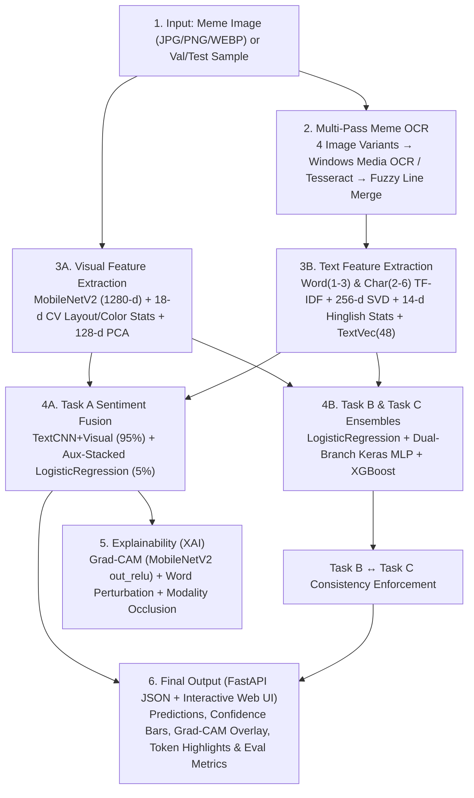

# IndicSent (MemeSense) — Multimodal Indian Meme Sentiment & Emotion Analysis

A multimodal AI web application (**MemeSense**) built on the **Memotion 3.0** dataset to analyze code-mixed Indian (**Hinglish**) and English internet memes across three tasks, complete with **Explainable AI (XAI)**, **Modality Comparative Analysis**, **Training Curves**, and **Confusion Matrix Evaluation**.

---

## Tasks Covered

- **Task A — Sentiment Analysis:** Classify overall meme sentiment into **Negative**, **Neutral**, or **Positive**.
- **Task B — Multi-Label Emotion Classification:** Detect four emotion categories simultaneously: **Humorous**, **Sarcastic**, **Offensive**, and **Motivational**.
- **Task C — Emotion Intensity Scales:** Quantify expression intensity (**0–3** for Humour, Sarcastic, Offensive; **0–1** for Motivational) with Task B↔C consistency enforcement.

---

## End-to-End Pipeline (Input → Output)



### Step-by-Step Pipeline Breakdown

1. **Input Ingestion ([server.py](server.py)):**
   - Users either upload a meme image (`POST /api/ocr`, `POST /api/analyze`, `POST /api/explain`) or select a sample from the Memotion 3.0 `val` (`1,500` labeled) or `test` (`1,500`) splits, with live editable OCR captions.
2. **Multi-Pass Meme OCR ([ocr_helper.py](ocr_helper.py), [ocr_run.ps1](ocr_run.ps1)):**
   - Generates four image preprocessing variants: original image, cubic-upscaled padded RGB, Gaussian unsharp-masked RGB, and a bright white-caption mask (`gray > 195`).
   - Runs **Windows Media OCR** (`Windows.Media.Ocr.OcrEngine`) on Windows or **Tesseract CLI** (`--psm 6`) on Linux/macOS, then scores and fuzzy-merges lines (`SequenceMatcher >= 0.62`) to suppress symbol noise.
3. **Multimodal Feature Extraction ([features.py](features.py), [predictor.py](predictor.py)):**
   - **Visual Branch:**
     - **MobileNetV2 (ImageNet pretrained, `160×160×3`, `pooling="avg"`):** Produces a **1280-d** L2-normalized embedding (plus **128-d PCA** projection for dense tree models).
     - **18-d CV Aesthetics & Layout Stats:** Aspect ratio, log pixel area, RGB channel means/stds, brightness mean/std, white/dark pixel fractions, top/bottom caption-bar whiteness, edge gradient density, HSV saturation mean/std, and warm color ratio.
   - **Text Branch:**
     - **Word + Char TF-IDF:** Word `1–3` n-grams (`40,000` features) + character `char_wb` `2–6` n-grams (`50,000` features), reduced to **256-d** via `TruncatedSVD`.
     - **14-d Lexical & Hinglish Meme Stats:** Log char/word counts, average word length, uppercase & digit ratios, `!`, `?`, newlines, `@`/`#`, quotes, Devanagari Unicode ratio, meme watermark hits (`mematic`, `rvcj`, `imgflip`, etc.), and Hinglish/English positive & negative lexicon counts.
     - **Sequence Tokens:** Keras `TextVectorization` (`MAX_TOK=15,000`, `SEQ_LEN=48`) for the Task A `TextCNN` branch.
4. **Multimodal Fusion & Prediction ([predictor.py](predictor.py), [train_models.py](train_models.py), [upgrade_task_a_and_curves.py](upgrade_task_a_and_curves.py)):**
   - **Task A (Sentiment):** Blends the dual-branch **`TextCNN + MobileNetV2`** network (`task_a_cnn.keras`, `95%`) with an **Auxiliary Emotion-Stacked `LogisticRegression`** (`5%`, stacked with 8-d probabilities from 4 binary emotion LR classifiers).
   - **Task B (4 Binary Emotions) & Task C (Intensity Scales):** Per-target OOF-tuned weighted probability blends of sparse `LogisticRegression`, Dual-Branch Keras MLP (`Dense 128 → Dense 96 → Softmax`), and `XGBClassifier` (`tree_method="hist"`).
   - **Task B ↔ Task C Consistency:** Inactive Task B predictions clamp Task C intensity to `0`; active Task B predictions ensure Task C selects the highest non-zero intensity class (`>= 1`).
5. **Explainability / XAI (`POST /api/explain` in [predictor.py](predictor.py)):**
   - **Visual Region Attribution (Grad-CAM):** Backpropagates the multimodal Task A score to `MobileNetV2`'s final spatial convolutional layer (`out_relu`, `5×5×1280`), producing a blended heatmap overlay (`Original` / `Grad-CAM` toggle) and 3×3 spatial region importance scores.
   - **Important Words (Leave-One-Word-Out Perturbation):** Masks each unique caption word and re-scores the full Task A multimodal ensemble to highlight supporting (`+`) and opposing (`-`) tokens inline and in ranked impact bars.
   - **Modality Contribution:** Compares full prediction probability against text-ablated and image-ablated runs to quantify **Text % vs. Visual %** contribution per meme.
6. **Evaluation & Comparative Analysis ([generate_evaluation.py](generate_evaluation.py), [artifacts/evaluation_report.json](artifacts/evaluation_report.json)):**
   - Computes validation metrics (`n=1,500`) across **Text-only**, **Image-only**, and **Text + Image (Multimodal)** models using Accuracy, Weighted/Macro Precision, Recall, F1-score, Confusion Matrices, and 12-epoch Keras training curves ([artifacts/training_curves.json](artifacts/training_curves.json)).

---

## Validation Results (Memotion 3.0, `n=1,500`)

### Comparative Modality Analysis

| Task | Modality | Accuracy | Precision (W) | Recall (W) | F1-Score (W) | F1-Score (Macro) |
| :--- | :--- | :---: | :---: | :---: | :---: | :---: |
| **Task A (Sentiment)** | Image-only | 32.87% | 33.63% | 32.87% | 31.26% | 30.79% |
| **Task A (Sentiment)** | Text-only | 34.80% | 35.49% | 34.80% | 33.14% | 31.97% |
| **Task A (Sentiment)** | **Text + Image (Multimodal)** | **35.93%** | **35.91%** | **35.93%** | **34.74%** | **33.61%** |
| **Task B (Emotions Avg)** | Image-only | 81.96% | 78.54% | 81.96% | 79.64% | 47.68% |
| **Task B (Emotions Avg)** | Text-only | 83.28% | 80.11% | 83.28% | 80.94% | 48.99% |
| **Task B (Emotions Avg)** | Text + Image (Multimodal) | 82.87% | 79.78% | 82.87% | 80.37% | 48.48% |
| **Task C (Intensity Avg)** | Image-only | 59.97% | 58.83% | 59.97% | 57.49% | 29.06% |
| **Task C (Intensity Avg)** | Text-only | 57.68% | 60.45% | 57.68% | 55.74% | 28.68% |
| **Task C (Intensity Avg)** | Text + Image (Multimodal) | 58.07% | 60.08% | 58.07% | 55.39% | 28.39% |

---

## Project Structure

```text
memotion_app/
├── server.py                      # FastAPI backend & API endpoints
├── predictor.py                   # MemotionPredictor (inference + Grad-CAM + word XAI)
├── features.py                    # MobileNetV2, 18-d CV stats, & 14-d Hinglish text features
├── ocr_helper.py                  # Multi-pass OCR preprocessing & fuzzy line merging
├── ocr_run.ps1                    # Windows Media OCR PowerShell runner
├── constants.py                   # Paths, label schemas, and Task B/C mappings
├── train_models.py                # Full multimodal training pipeline
├── generate_evaluation.py         # Text-only vs Image-only vs Multimodal evaluation & confusion matrices
├── upgrade_task_a_and_curves.py   # Task A TextCNN+Aux upgrade & 12-epoch training curve logger
├── static/
│   ├── index.html                 # MemeSense web UI (Analyzer, XAI, Explorer, Metrics & Eval)
│   ├── assets/                    # UI artwork & background
│   └── featured/                  # Featured meme fallbacks
├── artifacts/
│   ├── model_bundle.joblib        # Saved TF-IDF, SVD, PCA, scalers, LR & XGBoost models
│   ├── keras_models/              # Saved Keras neural networks & TextVectorization model
│   ├── metrics.json               # Summary validation metrics
│   ├── evaluation_report.json     # Full comparative metrics, confusion matrices & training curves
│   ├── training_curves.json       # 12-epoch Keras history (Image, Text, Multimodal)
│   ├── val_predictions.json       # Precomputed validation predictions + ground truth
│   └── test_predictions.json      # Precomputed test predictions
├── requirements.txt
└── Dockerfile
```

---

## API Endpoints

| Endpoint | Method | Description |
| :--- | :---: | :--- |
| `/` | `GET` | Serves the MemeSense web interface ([static/index.html](static/index.html)) |
| `/api/overview` | `GET` | Returns label schema, metrics, featured samples, and evaluation report |
| `/api/evaluation` | `GET` | Returns full comparative metrics, confusion matrices, and training curves |
| `/api/samples` | `GET` | Paginated & filterable `val` / `test` dataset explorer |
| `/api/image/{split}/{image_id}` | `GET` | Serves meme image for a dataset sample |
| `/api/ocr` | `POST` | Runs multi-pass OCR on an uploaded meme image |
| `/api/analyze` | `POST` | Predicts Task A sentiment, Task B emotions, and Task C intensity levels |
| `/api/explain` | `POST` | Returns Grad-CAM heatmap, word perturbation scores, and modality share |

---

## Running Locally

```bash
pip install -r requirements.txt
python server.py
```

Then open **http://127.0.0.1:8000** in your browser.

### Docker

```bash
docker build -t memesense .
docker run -p 8000:8000 memesense
```
